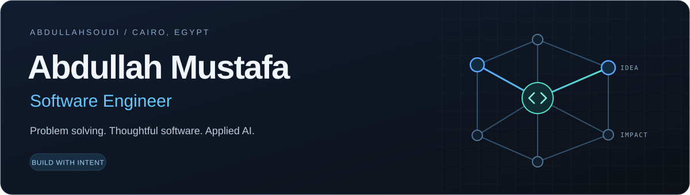

  

  <a href="https://www.linkedin.com/in/soudi26/"><strong>LinkedIn</strong></a>
  &nbsp; / &nbsp;
  <a href="#engineering-foundations"><strong>Foundations</strong></a>
  &nbsp; / &nbsp;
  <a href="#selected-work"><strong>Projects</strong></a>
  &nbsp; / &nbsp;
  <a href="#ai-in-my-workflow"><strong>AI workflow</strong></a>

I build web applications, APIs, research tools, and automation. My work brings together **software engineering fundamentals**, **practical product development**, and **AI-assisted workflows**.

## Engineering foundations

<table>
<tr>
<td width="50%" valign="top">
<h3>01 / Problem solving &amp; DSA</h3>

Breaking problems into clear steps, choosing suitable data structures and algorithms, and reasoning about correctness, time complexity, and memory usage.

</td>
<td width="50%" valign="top">
<h3>02 / Databases</h3>

Relational data modeling, SQL, and persistent application state. Hands-on project experience with <strong>SQL Server, PostgreSQL, and SQLite</strong>.

</td>
</tr>
<tr>
<td width="50%" valign="top">
<h3>03 / Competitive programming</h3>

<strong>ECPC participant — 2022 &amp; 2023</strong> 
<strong>IEEEXtreme participant</strong>

Applying algorithmic thinking to contest problems under time and memory constraints.

</td>
<td width="50%" valign="top">
<h3>04 / Teaching &amp; communication</h3>

<strong>Instructor at ICPC Minia — 2023</strong>

Making complex ideas easier to understand through clear explanations, step-by-step reasoning, and practical examples.

</td>
</tr>
</table>

## Selected work

<table>
<tr>
<td width="50%" valign="top">
<h3><a href="https://github.com/Nourhanshaban78/ElearningWebApplication">E-Learning Platform ↗</a></h3>

<strong>Collaborative .NET development</strong>

A team-built learning platform. I contributed student scheduling APIs for calendars, upcoming events, deadlines, and event details, merged in <a href="https://github.com/Nourhanshaban78/ElearningWebApplication/pull/51">PR #51</a>.

<code>C#</code> <code>ASP.NET Core</code> <code>SQL Server</code>

</td>
<td width="50%" valign="top">
<h3><a href="https://github.com/AbdullahSoudi/smart-agent-experiment">Smart Agent Experiment ↗</a></h3>

<strong>AI in a research setting</strong>

Built for a postgraduate researcher conducting an experiment with university students. Combines adaptive Arabic AI feedback with code-controlled scenarios, interaction logs, and authenticated researcher reports with CSV exports.

<code>Next.js</code> <code>TypeScript</code> <code>Groq</code> <code>PostgreSQL</code>

</td>
</tr>
<tr>
<td width="50%" valign="top">
<h3><a href="https://github.com/AbdullahSoudi/ITeacher">ITeacher ↗</a></h3>

<strong>Learning management</strong>

A teacher-focused learning application with student accounts, course enrollment, video lessons, and progress tracking. Includes teacher/student access roles and token-authenticated APIs.

<code>Laravel</code> <code>React</code> <code>SQLite</code> <code>Tailwind CSS</code>

</td>
<td width="50%" valign="top">
<h3><a href="https://github.com/AbdullahSoudi/SWE-Jobs">SWE Jobs ↗</a></h3>

<strong>Automation &amp; integrations</strong>

Discovers fresh software jobs and routes Telegram alerts by role. Handles duplicate detection, freshness checks, persistent delivery state, retries, and scheduled execution.

<code>Python</code> <code>SQLite</code> <code>Telegram API</code> <code>GitHub Actions</code>

</td>
</tr>
</table>

## AI in my workflow

**Claude Code · Codex · Cursor**

I use AI coding tools throughout development: exploring codebases, planning changes, implementing features, debugging, refactoring, and writing documentation.

- **Give useful context:** define the problem, constraints, and expected behavior.
- **Review the work:** examine generated code, architectural choices, and edge cases.
- **Verify the result:** use relevant tests and debugging checks before shipping.

My work also includes **building AI into applications**. In Smart Agent Experiment, the model evaluates responses while application code controls scenario branching, with validation and experiment version tracking.

## Technical toolkit

| Area | Technologies |
| :--- | :--- |
| Languages | C# · TypeScript · JavaScript · Python · PHP · SQL |
| Web & APIs | ASP.NET Core · Laravel · Next.js · React |
| Databases | SQL Server · PostgreSQL / Neon · SQLite |
| Development tools | Git · GitHub Actions · Claude Code · Codex · Cursor |
| Integrations | LLM APIs · Telegram API |

---

  <strong>Let's build something useful.</strong> 
  <a href="https://www.linkedin.com/in/soudi26/">Connect on LinkedIn</a> · <a href="https://github.com/AbdullahSoudi?tab=repositories">Explore my repositories</a>

